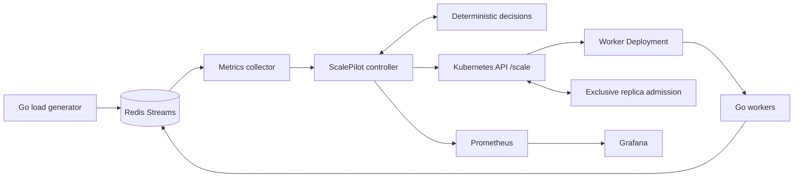
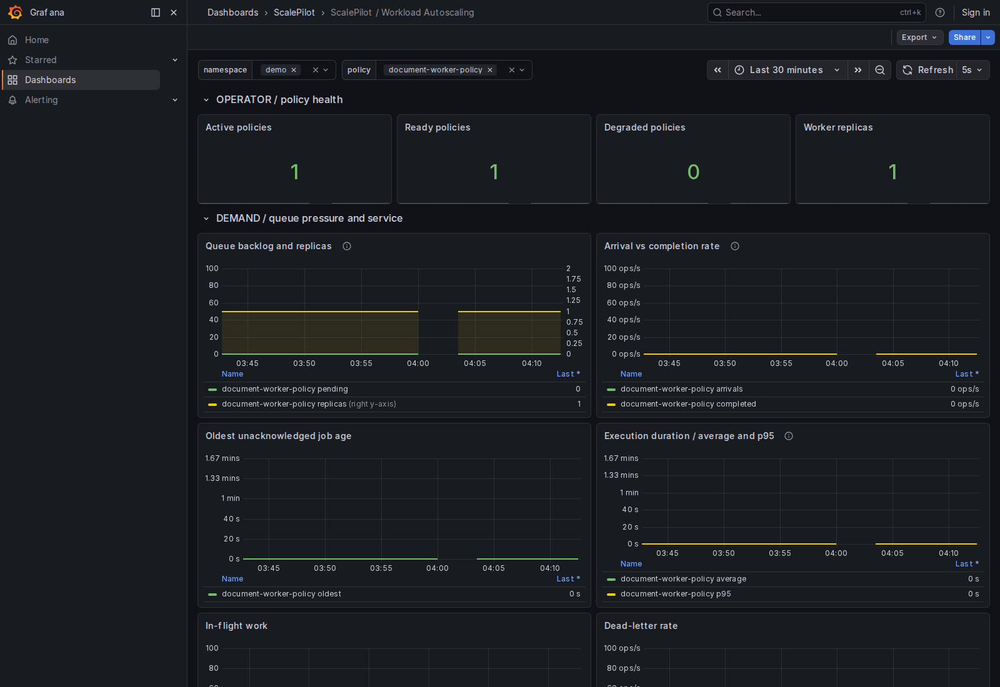
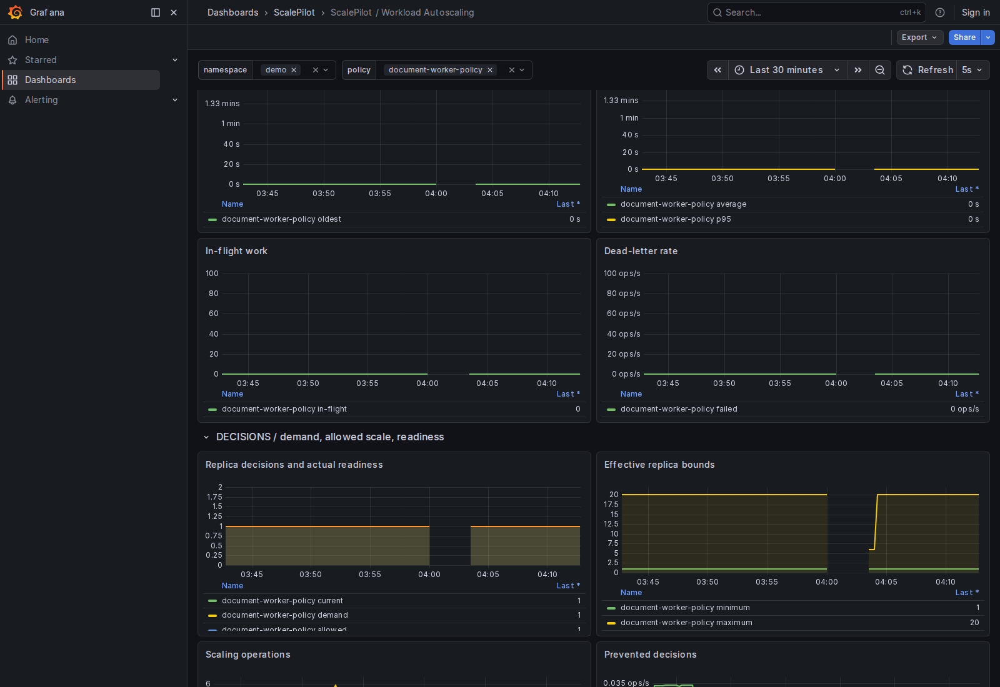

# ScalePilot

**A Kubernetes operator for background-worker autoscaling, implemented in Go.**

ScalePilot scales Deployments from real Redis queue backlog, message age, incoming work and measured execution capacity. It combines those signals with business-hour schedules, resource budgets, persisted cooldown/stabilization, readiness checks and exclusive replica ownership. CPU utilization alone can miss a large I/O-bound queue; queue length alone can miss in-flight work, slow execution and unsafe downscaling.

This repository contains the operator, generated CRDs/RBAC, recoverable worker queue, Go load generator, Helm chart, two-node Kind demo, Prometheus/Grafana monitoring, actual API/Redis/cluster tests and reproducible CPU-HPA comparisons. Nothing is published to a registry or GitHub automatically.

## What is implemented

- Native controller-runtime watches/reconciliation, bounded retries, `/scale` updates with resource versions, health probes and Lease-based leader election.
- `WorkloadScalingPolicy.autoscaling.scalepilot.io/v1alpha1`, OpenAPI/CEL validation/defaults and meaningful observed status/conditions.
- A pure deterministic demand engine with depth/drain/age/latency candidates, scheduled bounds, exact CPU/memory budgets, tolerance, rate limits and optional idle scale-to-zero.
- Durable recommendation history and pre-write scale intents so restarts do not erase safety windows.
- Direct HPA/duplicate-policy checks, per-target ownership Leases and a default-on admission webhook that rejects competing replica writers.
- Redis Streams consumer groups, PEL inspection/reclamation, ownership heartbeats, retries/dead letters, idempotent example effects and bounded real telemetry.
- Prometheus instrumentation, Kubernetes Events, structured JSON logs, optional OTLP tracing and automatically provisioned Grafana dashboards.

See [verification](benchmarks/reports/verification.md), [measured performance](benchmarks/reports/performance.md), [HPA experiments](benchmarks/reports/hpa-comparison.md) and [implementation/acceptance status](IMPLEMENTATION_STATUS.md). These distinguish executed evidence from unsupported or unverified capabilities. Hosted workflow outcomes are tracked separately in [GitHub Actions](https://github.com/i192009/scalepilot-operator/actions).

Browse the [captured result screens](screenshots/README.md) for the measured comparison matrix, executed verification and live Grafana views.

## Architecture



A Kubernetes operator observes custom resources and reconciles actual state toward declared policy. Informer events enqueue work; the controller reads current state, evaluates demand, applies safety controls and writes only necessary changes. Kubernetes remains responsible for creating/scheduling Pods. ScalePilot reports requested and ready capacity separately.

```mermaid
flowchart LR
  Event[Custom resource / workload event] --> Validate
  Validate --> Ownership[Check exclusive ownership]
  Ownership --> Collect[Collect real metrics]
  Collect --> Calculate[Calculate replicas]
  Calculate --> Policies[Schedules / budgets / history / cooldown]
  Policies --> Intent[Persist intent]
  Intent --> Execute[Recheck and execute /scale]
  Execute --> Status[Update observed status]
```



The separation between API models, queue collection, pure decisions, ownership, execution and status keeps the algorithm independently testable. [Architecture](docs/architecture.md) and [reconciliation](docs/reconciliation.md) explain the boundaries and failure behavior.

## Start locally

Prerequisites: Docker Linux engine, Go 1.27.4, GNU Make, Bash/curl/tar. See [full deployment instructions](docs/deployment.md), including Windows without host Go/Make/Helm.

Clone the public source repository first:

```bash
git clone https://github.com/i192009/scalepilot-operator.git
cd scalepilot-operator
```

```bash
export PATH="$HOME/.local/bin:$PATH"
TOOL_BIN="$HOME/.local/bin" bash scripts/bootstrap-tools.sh
make kind-create docker-build kind-load install-crds deploy deploy-demo monitoring-up
make generate-load
kubectl -n demo get wsp -w
```

On **Windows PowerShell**, Docker Desktop can host the development toolchain:

```powershell
function spdev { powershell -NoProfile -ExecutionPolicy Bypass -File .\scripts\dev.ps1 @args }
spdev setup
spdev make kind-create
spdev connect-kind
spdev make docker-build kind-load install-crds deploy deploy-demo monitoring-up
spdev make generate-load
spdev export-kubeconfig
kubectl --kubeconfig .kube/config -n demo get wsp -w
```

The helper's execution-policy setting applies only to its child PowerShell process; it does not change machine policy. This host had script execution disabled, so that invocation was verified explicitly.

The demo starts two managers, Redis with AOF/PVC and one worker. No traffic runs until requested. `make generate-load` enqueues 1,000 actual 500ms jobs. Observe queue growth, scale recommendations, requested replicas and subsequent readiness. After draining, observe gradual reduction under the demo's 60-second stabilization window and 30-second downscale cooldown. `make test-e2e` automates scaling, outages, worker interruption, leadership failover, resource constraints and HPA conflicts.

```bash
kubectl -n monitoring port-forward svc/grafana 3000:3000
# In another terminal:
kubectl -n monitoring port-forward svc/prometheus 9090:9090
```

Open [Grafana](http://localhost:3000/d/scalepilot/scalepilot-workload-autoscaling) and [Prometheus](http://localhost:9090). Windows host commands use `--kubeconfig .kube/config`. Grafana is local Viewer-only anonymous monitoring; use authentication before exposing it elsewhere. Dashboard JSON is under dashboards/grafana. These screenshots show real Prometheus data from the executed Kind failure/scaling demonstrations:

[](screenshots/grafana-overview.png)

[](screenshots/grafana-decisions.png)

The [screenshots gallery](screenshots/README.md) also includes the complete benchmark and verification result screens with capture provenance.

## Declare a policy

```yaml
apiVersion: autoscaling.scalepilot.io/v1alpha1
kind: WorkloadScalingPolicy
metadata:
  name: document-worker-policy
  namespace: demo
spec:
  scaleTargetRef: {apiVersion: apps/v1, kind: Deployment, name: document-worker}
  minReplicas: 1
  maxReplicas: 20
  metrics:
    redis:
      secretRef: {name: redis-connection}
      queueName: document-jobs
    targetQueueDepthPerReplica: 50
    targetDrainTime: 120s
    workerThroughput: 2
  behavior:
    scaleUp: {cooldown: 10s, maxPodsPerStep: 5, maxPercentPerStep: 100}
    scaleDown: {cooldown: 30s, maxPodsPerStep: 2, maxPercentPerStep: 25}
    stabilizationWindow: 60s
  resourcePolicy:
    maxTotalCPU: "2"
    maxTotalMemory: 1Gi
  safety: {onMetricsUnavailable: HoldCurrent, allowScaleToZero: false}
```

The Secret holds the endpoint/authentication/TLS configuration; passwords never belong in policy specs. The example's omitted thresholds/timeouts use schema defaults. See [the full functional manifest](deployments/demo/30-policy.yaml) and [API reference](docs/crd-reference.md).

## How decisions work

The engine takes the highest valid queue-depth, backlog-drain, remaining-age-budget and execution-capacity candidate. It then applies schedule minimum/maximum, exact resource ceilings, persisted downscale recommendation history, direction cooldown, tolerance and Pod/percentage steps. Incoming work is accounted for when estimating drain capacity. In-flight work protects active serial workers.

Missing/stale/invalid metrics hold current replicas and reset idle/low-demand evidence. Paused and dry-run policies do not write replicas. Optional scale-to-zero requires an explicit zero minimum, an external queue monitor and a sustained measured idle period; cold-start latency remains real. The formulas, precedence and boundary behavior are documented in [the scaling algorithm](docs/scaling-algorithm.md).

Schedules use embedded IANA tzdata, weekday/overnight windows and deterministic priority/name ordering. Repeated autumn wall-clock minutes match twice; nonexistent spring minutes do not occur. Resource ceilings include regular/init/sidecar requests and overhead, with exact quantities rather than float division. These budgets do not guarantee schedulable cluster capacity. See [schedules](docs/scheduling.md) and [resource safeguards](docs/resource-limits.md).

## Queue correctness, ownership and high availability

Unread Redis lag and in-flight PEL entries are separate. Workers heartbeat ownership, finish or relinquish on termination, reclaim interrupted deliveries and acknowledge only safely completed/dead-lettered work. Delivery is at least once; the example's 24-hour idempotency marker does not make arbitrary external effects exactly once. [Queue protocol](docs/redis-queue.md) explains retention, telemetry and lag fallback invariants.

Do not attach another autoscaler to an actively managed workload. The chart's replica admission guard rejects competing writes; runtime checks also suspend ScalePilot on HPA/duplicate-policy conflicts. Pause/delete the policy for an intentional ownership handoff. Policy deletion preserves the Deployment, replica count and queue. See [ownership and certificate operations](docs/ownership.md).

Only the Lease-elected manager reconciles; both replicas serve admission. Durable history and scale intent survive process failure. A new leader rechecks real replicas and honors persisted cooldown instead of replaying an old request. Multiple managers do not make Redis, storage or the Kubernetes control plane highly available. [Recovery](docs/failure-recovery.md) includes the restart sequence and executable failure matrix.

## Test and benchmark

```bash
make generate manifests fmt vet lint build
make test-unit test-race test-envtest test-integration
make helm-lint
make test-e2e
make benchmark
make benchmark-hpa
make benchmark-matrix
```

Unit/property tests use deterministic timestamps. Envtest starts real API server/etcd and verifies admission schema/status/scale behavior without claiming Pod execution. Testcontainers starts real Redis. Kind tests run real managers and workers, inject failures and assert observed outcomes. Every documented Make target performs work; requirements and diagnostics are in [deployment.md](docs/deployment.md).

The HPA CLI runs independent sequential arms with equivalent worker image, seeded traffic, resource requests and min/max replicas. It records real drain/reaction times, queue wait/execution distributions, Pod-seconds and resource samples. No general performance superiority is assumed. [Methodology](docs/hpa-comparison.md), raw JSON and [measured findings](benchmarks/reports/hpa-comparison.md) disclose ordering, sampling and environment limitations.

The complete recorded matrix contains 22 arms and 3,540 completed jobs with zero failures, including steady/ramp/burst traffic, short overload, long jobs, Redis outage, worker crash and each strategy's actual controller restart. [Post-run recovery checks](benchmarks/reports/restart-verification.json) confirmed replacement controller processes and healthy monitoring. Failure runs have sampling gaps and different controller topologies; they are recovery demonstrations rather than availability SLO comparisons.

Repeated spike subset measured on the same eight-CPU ARM64 Docker Desktop host, with 250 seeded 400ms jobs per arm and a 1–6 replica range:

| Profile | CPU HPA drain | ScalePilot drain | Pod-seconds: HPA / ScalePilot |
|---|---:|---:|---:|
| I/O, run 1 | 102.42s | 32.45s | 102.36 / 119.62 |
| I/O, run 2 | 103.07s | 32.64s | 103.02 / 120.16 |
| CPU, run 1 | 38.71s | 32.55s | 116.42 / 118.10 |

All 1,500 jobs completed with zero failures in this spike subset. ScalePilot used more sampled Pod-seconds in these runs; this is a local latency/capacity tradeoff, not a universal efficiency claim. A separate 100-job burst/idle pair showed little difference: HPA 41.97 seconds versus ScalePilot 41.33 seconds, both at one replica. See the [full measured matrix](benchmarks/reports/hpa-comparison.md). Resource summaries use available Metrics Server samples and can omit new Pods. The pure engine benchmark measured a 158.1ns median per decision, 32 bytes and one allocation, excluding I/O. At 1,000 dry-run policies only 719 had been observed by the end of the 30-second post-creation window, with a reconcile queue depth of 900. See [performance limits and raw evidence](benchmarks/reports/performance.md).

## Repository

```text
api/v1alpha1/            Go API, defaults/validation markers, generated DeepCopy
cmd/                    manager, worker, loadgen, benchmark, policybench
internal/               controller, scaling, queue, metrics, workload, security, observability
config/crd/             generated CRDs and Kustomize CRD installation
config/rbac/            generated operator permissions
charts/scalepilot/      Helm packaging, RBAC, admission TLS, metrics, NetworkPolicy
deployments/            Kind cluster, demo Redis/workers/policy, monitoring stack
examples/               explicit bounded load-generation Job
dashboards/grafana/     provisioned live dashboard JSON
tests/                  real Redis integration, envtest, Kind acceptance/failures
benchmarks/reports/     executed measurements and raw evidence
screenshots/            selected dashboard and result captures
scripts/                tooling, PowerShell development, setup, cleanup, capture
docs/                   API/algorithm/operations/recovery/security and ADRs
.github/workflows/      CI, Kind acceptance and explicit release dispatch
```

## Security, limitations and next improvements

The chart uses scoped RBAC, non-root scratch images, read-only root filesystems, dropped capabilities, resource limits and network controls. Kind's default CNI does not enforce NetworkPolicies. Namespace Secret access, admission availability, certificate rotation, authenticated Redis/monitoring and persistent backups need explicit production design. [Security](docs/security.md) describes these boundaries.

Initial support is same-namespace Deployments and this single-consumer-group serial-worker queue protocol. There is no predictive model, KEDA comparison, namespace free-capacity scheduler, StatefulSet controller, multi-group queue support or automatic admission-certificate rotation. Resource-budget reductions may converge gradually to preserve safety. The local Redis deployment is not an HA durability guarantee.

Production release qualification, alternate Kubernetes/CNI platforms, prolonged high-cardinality ownership load, authenticated TLS/mTLS E2E, OTLP backend validation and multi-platform release publication are separate validation work. Prioritize those before production adoption. Major decisions are recorded in [ADRs](docs/adr/).
