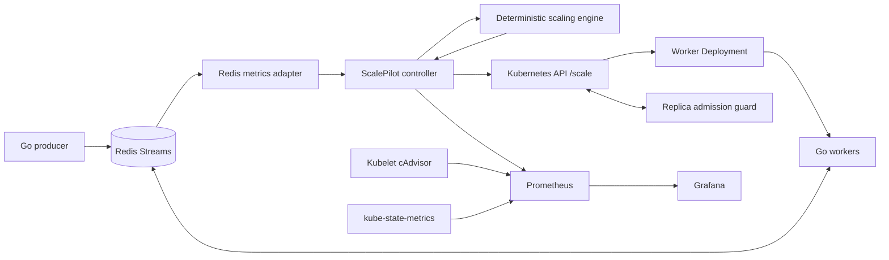

# Architecture

ScalePilot is a controller-runtime manager with one WorkloadScalingPolicy reconciler. Kubernetes stores the policy, observed status, recommendation history, pending scale intents, and ownership Leases. Redis is a source of measured demand; it is not a second configuration database.

The API package depends on Kubernetes API machinery only. `internal/scaling` performs no I/O. `internal/queue` owns the Streams protocol and real worker telemetry. `internal/metrics` resolves Secrets, configures TLS, and shares Redis connection pools. `internal/workload` owns conflict checks, target Leases, and scale-subresource updates. `internal/security` validates replica writes. `internal/controller` coordinates these components and produces durable status.

The supported workload is a same-namespace `apps/v1` Deployment with serial workers. The Scaler interface separates scale execution so other scale-enabled kinds can be added without rewriting the decision engine. There is no finalizer: policy deletion requires no external cleanup. Kubernetes garbage-collects its ownership Lease; the workload and Redis data remain.

The default chart installs two managers with one Lease-elected reconciler. Both managers serve admission and metrics. A namespaced Role limits workload access to the configured namespace; cluster-wide operation is an explicit Helm option. The admission configuration is cluster-scoped but selects the managed namespace.

Prometheus scrapes both managers, kube-state-metrics, and cAdvisor. Its optional demonstration RBAC permits cluster read access for discovery and node metrics. This is separate from the operator identity. The supplied monitoring stack is ephemeral and intended for local Kind use.
