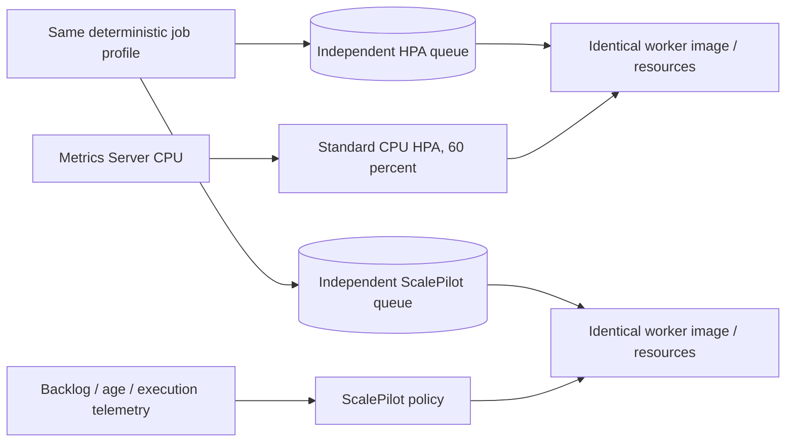

# HPA comparison methodology

The recorded local session includes a host pause between the steady and ramp profiles. Raw UTC start times preserve that gap; this was not one uninterrupted experiment session. Each arm still creates a fresh workload/queue and warms independently.

Run `make benchmark-hpa` for the repeated 250-job spike subset and `make benchmark-matrix` for steady, gradual ramp, burst/idle, overload, long-job, Redis-outage, worker-crash and controller-restart pairs. Both require the isolated Kind demo. The matrix script supervises a local Redis port-forward so it reconnects after Redis Pod replacement; it restores Redis and stops that forward on exit. Run `go run scripts/report-benchmarks.go` to regenerate tables from completed audit files.

The additional matrix uses 100 jobs at 400ms for steady/ramp/burst/overload, 20 jobs at 3s for long processing, and 200 jobs at 400ms for failure profiles. Steady/burst base traffic is five jobs/second; ramp increases from five toward fifty; overload is 200 jobs/second; failure profiles use ten jobs/second. Each profile runs once per strategy. This bounds local experiment cost and does not characterize sustained production overload. The burst profile alternates ten-second traffic and idle windows during production; resource accounting still stops at final drain.

Failures are injected after ten seconds of measured work. Worker crashes force-delete this arm's Pods. Redis scales to zero for ten seconds before restoration; restart time is additional. Producers retry the same job ID for at most one minute and keep idempotent completion effects; enqueue delivery itself can be ambiguous. Retries pause subsequent arrivals, so this is a bounded recovery check with producer backpressure, not an arrival-rate-controlled outage experiment. The sampler pauses during the Redis fault operation, including a ten-second restart allowance, so collection-failure counts do not count that intentional gap and failure-run Pod-seconds are approximate.

For controller restart, HPA's actual Kind kube-controller-manager CRI container is stopped and kubelet restarts the static Pod. Deleting its mirror Pod would not exercise a process restart. ScalePilot's active lease leader is force-deleted, allowing the other manager to take over. These topologies differ, and the HPA fault also interrupts other built-in controllers. The recorded recovery runs are not an equivalent availability SLO comparison. Raw files record the fault target and producer retry count.

The CPU profile burns SHA-256 work for a configured wall-clock duration; it is simulated CPU-intensive processing, not a fixed-instruction business task. Resource contention and startup variation can affect these local results.

CPU/memory summaries sum the Pod metrics currently available from Metrics Server. Freshly started Pods may not yet have samples, so these observed sums can underrepresent total workload usage during startup. They must not be used as complete resource/cost totals or as evidence of CPU efficiency. Queue/drain, replica and completion-audit measurements are independent of that resource-sampling limitation.

The executable CLI runs arms sequentially in the same Kind cluster. Each arm starts at one replica, allows six, requests 100m CPU/32Mi memory per worker, limits CPU to one core/memory to 128Mi, and warms for 30 seconds. The same random seed produces the same execution durations. CPU HPA uses the standard resource metric at 60% of the declared CPU request; there is no intentionally broken CPU target. ScalePilot uses the supplied demand policy and a 15-second downscale history window.

Every run gets a new independent queue and worker Deployment. Never attach both controllers to the same workload to compare performance. The CLI deletes each arm's scaler before deleting the workload. A separate idle demo worker and monitoring/control-plane overhead remain common to both arms.

Samples record real backlog, PEL, requested/ready replicas, Redis collection latency, API-read latency and Metrics Server CPU/memory. Pod-seconds integrate observed live Deployment replicas between samples; ready-Pod-seconds are separate. Polling is approximately one second plus collection/API overhead. Reaction time is null when no scale-up is observed; scale-step counters count observed replica transitions, so multiple changes between polls may be missed.

Completion audit records produce exact sample averages/nearest-rank p95 queue wait and execution duration for these bounded experiments. The CLI rejects runs without a full job audit. This p95 differs from the live monitoring histogram's bucket upper bound. Drain time is wall time from enqueue start until all jobs acknowledge, including polling delay. Metrics Server CPU samples represent its collection window rather than instantaneous work.

The report only claims experiments actually executed; see [results](../benchmarks/reports/hpa-comparison.md) and raw JSON. One local run is not statistically significant. For evidence beyond a demonstration use repeated runs, alternate arm order, collect node pressure, vary CPU and I/O profiles, and characterize startup variability. The current CLI runs HPA first, which can introduce ordering/cache bias. It measures through queue drain and does not include a long post-drain downscale tail in Pod-seconds.

Expected tradeoffs are workload dependent: a CPU HPA can respond well to sustained CPU-bound work without requiring application-specific telemetry; queue-aware scaling can respond to I/O backlogs that do not consume much CPU. Neither is universally faster or cheaper. KEDA and custom/external-metric HPA are established queue-aware alternatives; no KEDA comparison is implemented or claimed.
