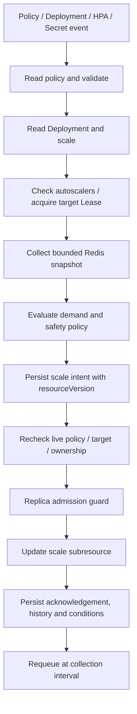

# Reconciliation and crash consistency

Durable decision/evaluation/idle/history timestamps use Kubernetes metav1.MicroTime. Whole-second JSON timestamps can otherwise shorten a cooldown after an API round trip; a fractional-second JSON restart test protects this boundary. Standard condition timestamps remain metav1.Time.

Reconciliation has a 30-second context deadline. Redis has a separate policy timeout and bounded retries. API/scale errors return for controller-runtime backoff; invalid configuration produces status and a controlled requeue. There are no unbounded goroutine-per-policy loops.

The controller indexes policies by Deployment name. Deployment and HPA watches map target changes to policies; Secret watches cache metadata only and enqueue referencing policies. Policy watches use generation predicates so status writes do not self-trigger a loop. Readiness changes between samples can still update status. A NextEvaluationTime gate avoids extra metric sampling on repeated workload events. Status uses resourceVersion updates and skips semantic no-ops.

The durable history contains raw constrained recommendations, not repeatedly reduced final replica values. A scale action requires successful intent persistence before the API update. If the process fails after either step, the next leader reads the actual scale and conservatively honors the intent's cooldown; it does not replay a stale desired replica count. LastScaleAttemptTime is separate from LastScaleTime: failed/ambiguous attempts consume safety time without being reported as successful scaling. Recovery recognizes an intent's success only when the same target UID is observed at its intended replica count. Some ambiguous/failed intents may delay a later scale unnecessarily, which is the chosen safe failure mode.

Conditions distinguish readiness, metric availability, active scaling, limiting policies, degradation and ownership conflicts. Ready replicas come from Deployment status, not the requested scale value. API admission validates schema/CEL constraints; additional IANA timezone and exact resource-budget checks mark policies InvalidPolicy/InvalidResourceRequests at runtime.
