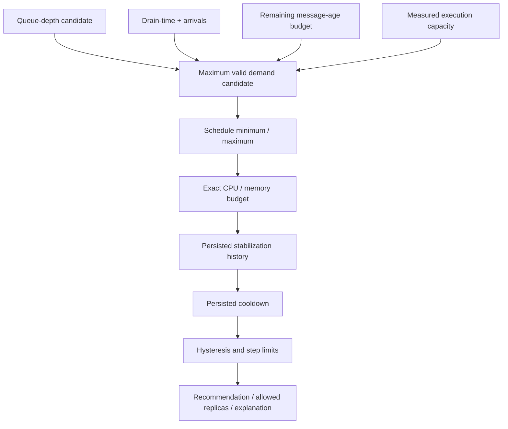

# Scaling algorithm

Let `P` be unread jobs, `I` in-flight jobs, `λ` measured arrivals/second over a rolling 60-second window, and `μ` serial-worker service rate. `μ = 1 / measured average execution duration`; a configured workerThroughput is used only when no recent execution sample exists. No duration or completion data is manufactured when workers have not run.

Candidates:

| Signal | Recommendation |
|---|---|
| Queue depth | `ceil(P / targetQueueDepthPerReplica)` |
| Drain time T | `ceil(((P + I) / T + λ) / μ)` when μ is known |
| Age SLA A | `ceil((P / max(collectionInterval, A - oldestAge) + λ) / μ)` when P > 0 and μ is known |
| Execution latency | `ceil(λ * measuredP95ExecutionDuration)` when work is waiting and p95 exceeds targetProcessingLatency |
| In-flight protection | `min(currentReplicas, I)` for this serial-worker queue |

Take the maximum candidate. The age formula represents the service capacity needed within the remaining waiting-time budget; once overdue, it uses one collection period. Execution latency and queue waiting time remain distinct. Expensive execution without queued demand does not alone authorize scale-up. This is reactive demand estimation, not forecasting.

Order of operations:

1. Reject missing, future, stale, negative, NaN, infinite, or inconsistent samples.
2. Evaluate schedules in IANA local time; derive effective minimum and maximum.
3. Intersect maximum with configured resource budgets and replica ceiling. An impossible minimum/budget combination holds current capacity and reports degradation.
4. Calculate the maximum demand candidate and apply optional activation/idle-zero rules.
5. Clamp the raw recommendation to feasible bounds and retain it in durable status.
6. For downscale, use the highest raw recommendation in the stabilization window. A new policy seeds its current capacity into history. One point per collection period retains that period's maximum.
7. Hold downscale while current requested capacity is not ready. Desired and ready are separate fields.
8. Apply the longer of direction cooldown and minimum interval after the last scaling action. A persisted ambiguous scale intent also supplies a conservative timestamp.
9. Apply relative tolerance while the current count is within effective bounds.
10. Apply the tighter absolute and percentage step limit. Downward percentages round down with a minimum one-Pod step; upward percentages round up.
11. Paused/dry-run policies retain their calculated recommendation but make no replica writes.

Bounds constrain new requests. If a budget is reduced below already running capacity, cooldown, in-flight/readiness protection and step limits can delay convergence; budgets are not eviction guarantees. An impossible minimum does not silently scale the workload to zero.

Metrics failures hold replicas by default and restart the low-demand/idle evidence window. `ScaleToMinimum` is an availability floor: it can raise an under-provisioned workload to its minimum, never authorize metrics-blind downscale. Missing metrics do not mean an empty queue.

Scale-to-zero is opt-in, requires `minReplicas: 0`, and defaults to a 300-second measured idle period (minimum configurable 30 seconds). Activation occurs on unread/in-flight work or positive arrival rate using activationReplicas, subject to all limits. Redis group-lag inspection works without any worker Pods. Cold starts and Redis/control-plane availability still determine activation latency.

