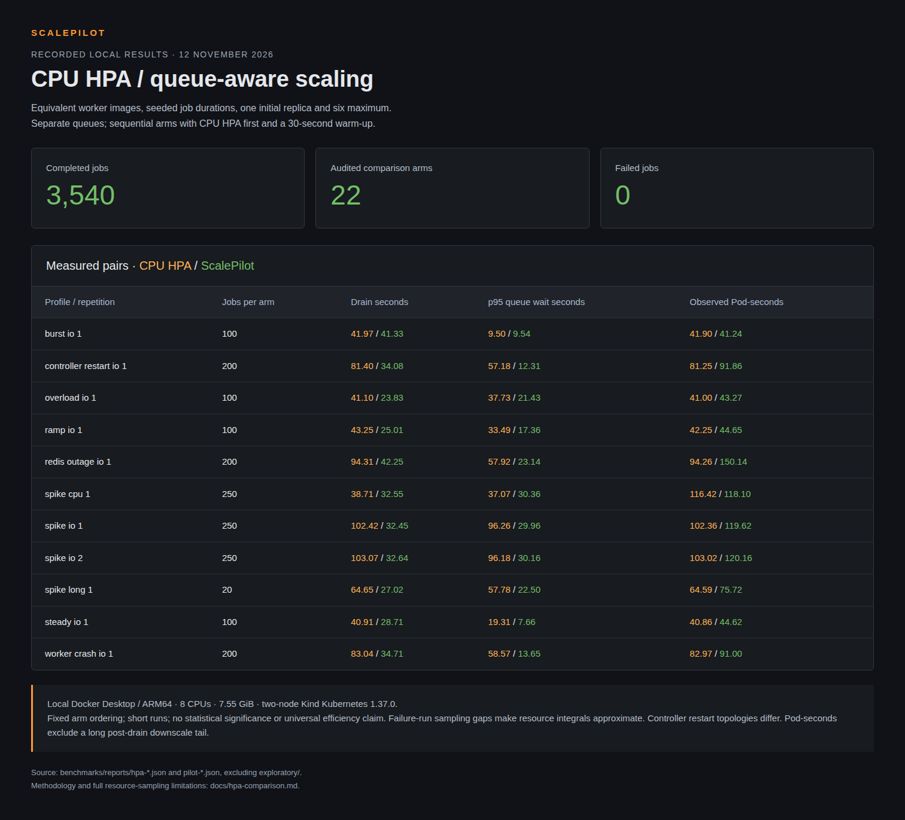
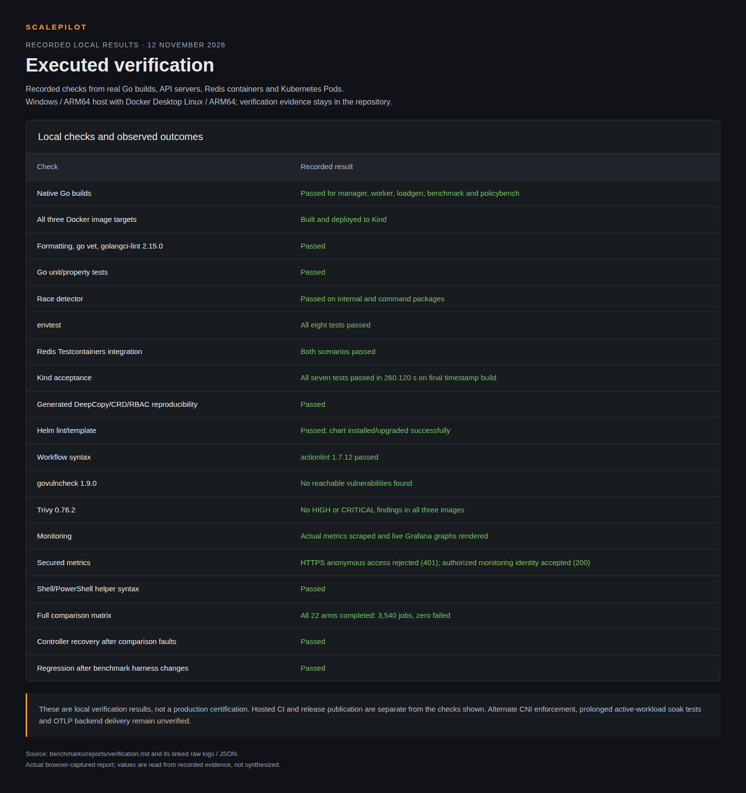
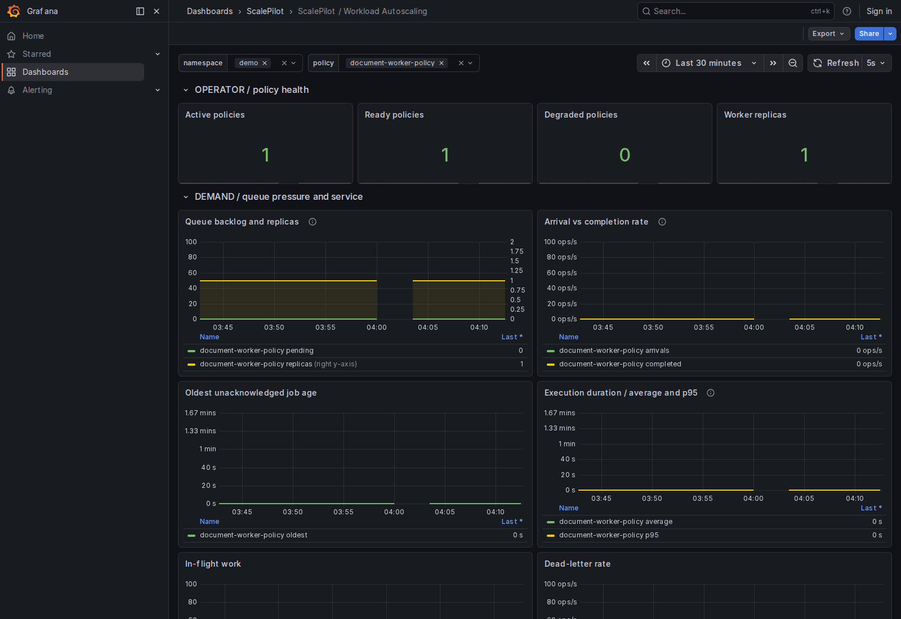
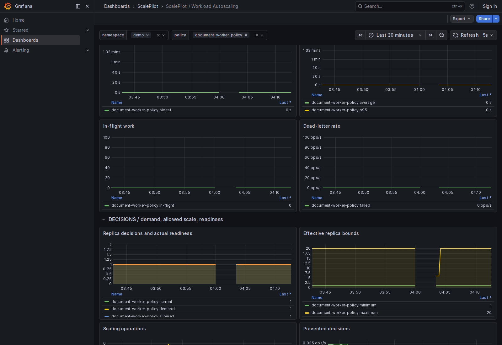

# ScalePilot screenshots

Selected publication captures from the actual local Kind demonstration and recorded verification on **12 November 2026**. The gallery follows the existing project style: dark monitoring views, linked full-size images, capture details and reproducible evidence.

The Grafana images are unmodified browser captures of the provisioned dashboard backed by real Prometheus data. The results images are browser captures of reports rendered directly from the completed benchmark JSON and verification record, using the dashboard's dark palette. They are report views, not an additional application dashboard.

| File | Result screen | Dimensions |
|---|---|---|
| [grafana-overview.png](grafana-overview.png) | Live policy health, queue demand and measured service telemetry | 1600 × 1100 |
| [grafana-decisions.png](grafana-decisions.png) | Requested/ready capacity, recommendations and configured limits | 1600 × 1100 |
| [benchmark-results.png](benchmark-results.png) | All measured CPU-HPA / ScalePilot pairs and completed-job audits | 1512 × 1371 |
| [verification-results.png](verification-results.png) | Recorded build, test, security and recovery outcomes | 1512 × 1608 |

## Main views

## Evidence and reproduction

See the [raw comparison results](../benchmarks/reports/hpa-comparison.md), [verification evidence](../benchmarks/reports/verification.md), [experiment methodology](../docs/hpa-comparison.md) and [browser capture instructions](../docs/deployment.md#optional-actual-screenshot-capture). The original Grafana capture time and report capture times are preserved in [capture.json](capture.json), alongside SHA-256 hashes of the selected images.

Using the pinned Playwright image from the deployment guide, run `node scripts/capture-results.mjs` to rebuild the results captures from the checked-in evidence. Run `node scripts/capture-dashboard.mjs` against the live demo to refresh the original Grafana captures, then rerun the results capture script to refresh their publication copies.

The local comparisons use fixed arm ordering, short workloads and partial resource samples. They do not establish production capacity, cost efficiency or an availability SLO. The reports document remaining validation limits.
